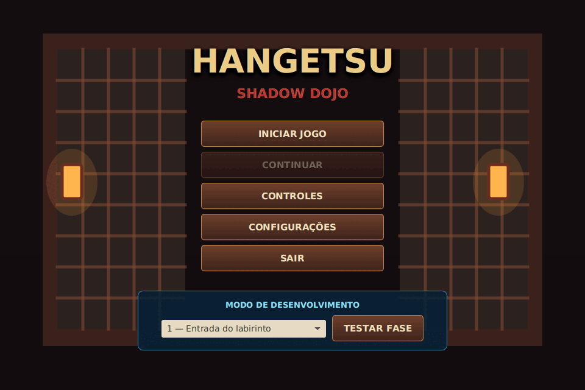
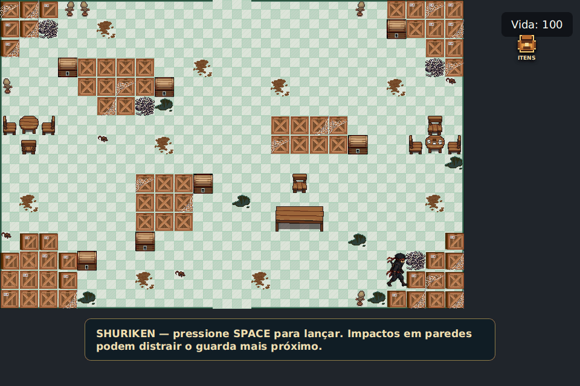
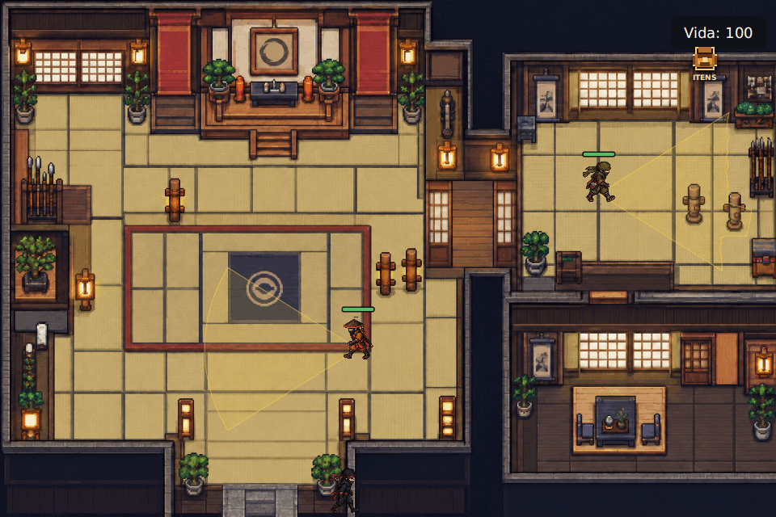
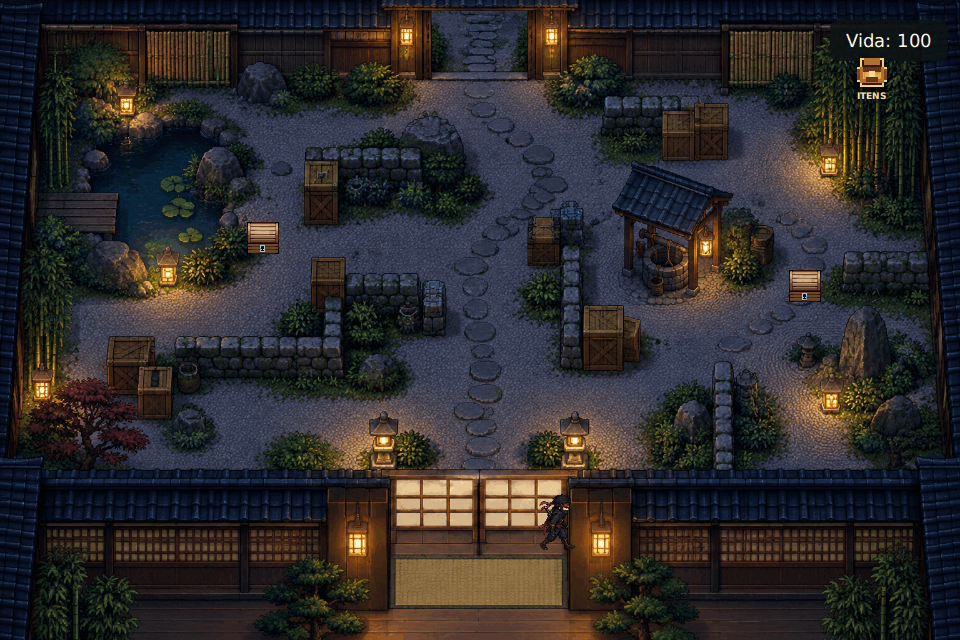
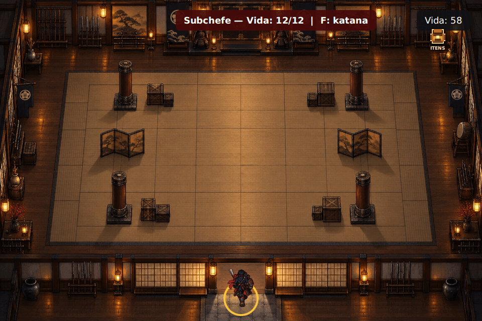
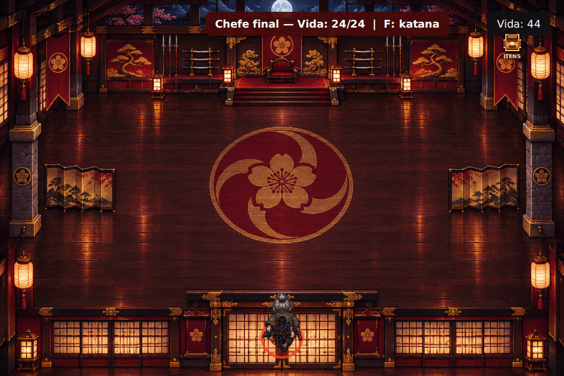
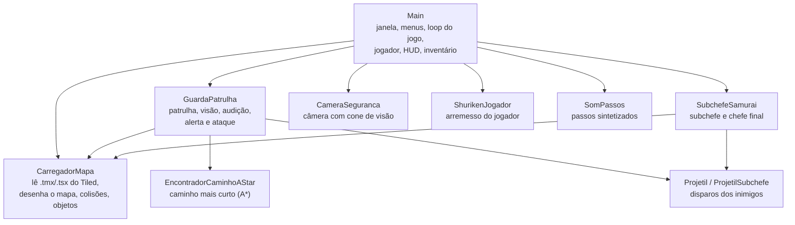

# Hangetsu: Shadow Dojo

Jogo de **furtividade e ação em 2D, visto de cima**, ambientado em um dojo japonês. O jogador controla um ninja que precisa atravessar o dojo sem ser visto, enfrentar um subchefe e, no fim, o chefe final. O projeto foi feito em **Java 21 com JavaFX**, com os mapas desenhados no editor **Tiled**.



## Sumário

- [Visão geral](#visão-geral)
- [Como executar](#como-executar)
- [Controles](#controles)
- [Como jogar](#como-jogar)
- [Fases](#fases)
- [Inimigos](#inimigos)
- [Itens e inventário](#itens-e-inventário)
- [Progresso e salvamento](#progresso-e-salvamento)
- [Arquitetura do projeto](#arquitetura-do-projeto)
- [Detalhes técnicos](#detalhes-técnicos)
- [Estrutura de pastas](#estrutura-de-pastas)
- [Como criar ou editar uma fase](#como-criar-ou-editar-uma-fase)
- [Modo de desenvolvimento](#modo-de-desenvolvimento)
- [Fluxo de trabalho da equipe](#fluxo-de-trabalho-da-equipe)
- [Equipe](#equipe)

## Visão geral

| | |
|---|---|
| **Gênero** | Furtividade / ação com visão de cima (top-down) |
| **Linguagem** | Java 21 |
| **Interface gráfica** | JavaFX 21.0.2 |
| **Build** | Apache Maven |
| **Editor de mapas** | [Tiled](https://www.mapeditor.org/) (arquivos `.tmx` e `.tsx`) |
| **Fases** | 10 fases principais e 3 salas laterais |
| **Arte** | Pixel art, com tilesets e sprites na pasta `assets/` |

A ideia central é que **barulho e visão importam**. Os guardas enxergam em um cone, ouvem passos, reagem a objetos arremessados e investigam o que ouviram. O jogador escolhe entre andar rápido, andar em silêncio, distrair os guardas, bloquear a visão deles ou eliminá-los.



## Como executar

### Requisitos

- **JDK 21** ou superior
- **Apache Maven** 3.8 ou superior
- Conexão com a internet na primeira execução, para o Maven baixar as dependências (JavaFX)

Confira as versões instaladas:

```bash
java -version
```

```bash
mvn -version
```

### Passo a passo

1. Clone o repositório:

```bash
git clone https://github.com/xJuan0409/DojoGame.git
```

2. Entre na pasta do projeto:

```bash
cd DojoGame
```

3. Compile:

```bash
mvn compile
```

4. Execute o jogo:

```bash
mvn javafx:run
```

A classe principal é `com.dojogame.Main`, configurada no `pom.xml` pelo `javafx-maven-plugin`. O JavaFX é baixado pelo Maven, então não precisa instalá-lo à parte.

### Executar pela IDE

O projeto abre normalmente no IntelliJ IDEA (a pasta `.idea/` está no `.gitignore`). Abra o `pom.xml` como projeto Maven e execute `com.dojogame.Main`. Se a IDE reclamar de componentes do JavaFX ausentes, use `mvn javafx:run`.

## Controles

Todos os atalhos podem ser alterados no menu **Configurações** (ou em **Controles**, que mostra a lista atual). Os valores abaixo são os padrões.

| Ação | Tecla |
|---|---|
| Mover (cima, esquerda, baixo, direita) | `W` `A` `S` `D` |
| Andar silenciosamente (furtivo) | `Shift` |
| Interagir, abrir baús e atravessar portas | `E` |
| Lançar shuriken | `Espaço` |
| Bomba de fumaça | `Q` |
| Usar kit médico | `H` |
| Usar katana | `F` |
| Reiniciar após a derrota | `R` |
| Pular tutorial | `T` |
| Pausar | `Esc` |
| Mostrar caminhos do A* e colisões (depuração) | `F3` |

## Como jogar

O objetivo de cada fase é chegar à **saída** sem morrer. Quando o jogador chega perto dela, o jogo mostra um aviso e permite avançar.

### Furtividade e barulho

- **Andar normalmente** (220 px/s) faz barulho. Um círculo dourado em volta do personagem mostra até onde os passos podem ser ouvidos (cerca de 145 px).
- **Andar com `Shift`** é mais lento (120 px/s), mas muito mais silencioso (cerca de 42 px).
- **Shuriken** que acerta uma parede faz ruído (cerca de 180 px) e pode atrair o guarda mais próximo.
- **Bomba de fumaça** bloqueia a visão por 5 segundos, mas a explosão faz bastante barulho (cerca de 230 px).

### Estados de um guarda

Os guardas indicam o que estão pensando com um símbolo acima da cabeça:

| Símbolo | Significado |
|---|---|
| (nenhum) | Patrulhando a rota desenhada no mapa |
| `?` | Ouviu algo e está **investigando** |
| `!` | **Viu o jogador** e entrou em alerta ou perseguição |

Depois do alerta, se o jogador escapar da visão, o guarda procura por um tempo e então **retorna à patrulha**. Fora do alerta os guardas andam devagar. Em perseguição ficam bem mais rápidos, o que deixa a infiltração mais segura do que sair correndo.



### Vida e derrota

- O jogador começa com **100 de vida**.
- Se a vida chegar a zero, aparece a tela de derrota. Pressione `R` para recomeçar.
- Os itens carregados ficam em uma **bolsa no local da derrota**. Ao voltar até lá, o jogador recupera os itens perdidos.

## Fases

| # | Fase | Arquivo do mapa | Destaques |
|---|---|---|---|
| 1 | Entrada do labirinto | `entrada_labirinto.tmx` | Tutorial de movimento e furtividade |
| 2 | Armazém do dojo | `armazem_dojo.tmx` | Baús com itens e tutorial de shuriken, fumaça e kit médico |
| 3 | Dojo dos guardas | `dojo_guardas.tmx` | Primeira patrulha com cones de visão |
| 4 | Sala de treinamento | `sala_treinamento.tmx` | Patrulhas de guardas em uma sala de treino |
| — | Salas laterais | `sala_lateral_deposito.tmx`, `sala_lateral_guarda.tmx`, `sala_lateral_vazia.tmx` | Salas opcionais, acessadas por portas laterais |
| 5 | Pátio noturno | `patio_noturno.tmx` | Mapa aberto, com iluminação noturna |
| 6 | Arena do subchefe | `arena_subchefe.tmx` | Primeira luta contra um chefe |
| 7 | Corredor final: depósito | `sequencia_final_1.tmx` | Início da sequência final, com 2 câmeras de segurança |
| 8 | Corredor final: arsenal | `sequencia_final_2.tmx` | 2 câmeras de segurança |
| 9 | Corredor final: tatame | `sequencia_final_3.tmx` | Último trecho antes do chefe, com 2 câmeras de segurança |
| 10 | Arena do chefão final | `arena_chefao_final.tmx` | Chefe final em três fases |



## Inimigos

### Guardas

Existem três tipos de guarda, definidos em `GuardaPatrulha.TipoVisual`. Nas fases, os guardas de cada rota alternam automaticamente entre **comum** e **distância**; o tipo **reforço** aparece só na luta contra o subchefe.


| Tipo | Comportamento |
|---|---|
| **Comum** | Combate corpo a corpo e persegue o jogador de perto. |
| **Distância** | Mantém distância e dispara projéteis. Dispara enquanto corre, desde que veja o jogador. |
| **Reforço** | Chamado durante a luta com o subchefe. |

Cada guarda tem **5 pontos de vida** e pode ser nocauteado com shurikens. A velocidade muda conforme o estado: patrulha (48), busca (72), retorno (55) e perseguição (de 112 a 152, conforme o tipo).

### Câmeras de segurança

Aparecem nas fases 7, 8 e 9, duas em cada. Alternam entre períodos de pausa e **vigilância** (pulso vermelho). Se o jogador estiver dentro do cone durante o pulso, o **alerta é disparado** e os guardas passam a perseguir.

### Subchefe samurai

Primeiro chefe do jogo, na fase 6. Tem **12 pontos de vida**, persegue o jogador, golpeia de perto e faz **investidas**. Ao chegar na metade da vida entra em uma **segunda fase**, mais rápida, e chama reforços. Ele também deixa itens pelo chão. A **katana** do jogador só é liberada depois da segunda investida dele.



### Chefe final

Usa a mesma base do subchefe, mas com **24 pontos de vida** e três fases:

1. Ataques básicos, parecidos com os do subchefe.
2. Passa a lançar **projéteis**.
3. Usa o **arsenal completo**.



## Itens e inventário

| Item | Como usar | Efeito |
|---|---|---|
| **Shuriken** | `Espaço` | Arma de arremesso. Nocauteia guardas e, ao bater numa parede, distrai quem estiver perto. |
| **Bomba de fumaça** | `Q` | Bloqueia a visão por 5 segundos, mas faz barulho. |
| **Kit médico** | `H` | Recupera 20 pontos de vida (máximo 100). |
| **Katana** | `F` | Arma corpo a corpo, liberada na luta contra o subchefe. |

Os itens vêm dos **baús** espalhados pelas fases. Para abrir um, chegue perto e pressione `E`. Os baús têm **loot aleatório**, por exemplo shurikens, bombas de fumaça ou kits médicos. Os baús abertos continuam abertos mesmo depois de fechar o jogo. O botão **ITENS**, no canto da tela, abre a mochila com as quantidades e os atalhos de cada item.

## Progresso e salvamento

O jogo salva o progresso automaticamente, sem arquivo de save visível. Ele usa a API `java.util.prefs.Preferences` do Java, que guarda os dados nas preferências do usuário do sistema (no Windows, o registro; no Linux e no macOS, arquivos de configuração do usuário).

Ficam salvos: fase atual e saída usada, vida, quantidade de shurikens, bombas de fumaça e kits médicos, posse da katana, **checkpoint do subchefe**, baús já abertos, tutoriais concluídos, volume e atalhos de teclado.

- **Continuar** retoma do ponto salvo.
- **Iniciar jogo** começa um novo jogo e apaga o checkpoint do subchefe (o menu avisa antes).

## Arquitetura do projeto

O código fica em `src/main/java/com/dojogame/`, com cerca de 8 mil linhas de Java. Cada classe tem uma responsabilidade.



| Classe | Responsabilidade |
|---|---|
| `Main` | Ponto de entrada (`Application` do JavaFX). Cria a janela, os menus (inicial, pausa, controles, configurações), o loop do jogo, o jogador, a câmera, o HUD, o inventário, o tutorial e o salvamento. |
| `CarregadorMapa` | Lê os mapas do Tiled, desenha as camadas de tiles em um `Canvas`, e extrai colisões, spawn do jogador, saída, baús, portas, rotas dos guardas e câmeras. |
| `GuardaPatrulha` | Inimigo comum. Controla patrulha, cone de visão, audição, alerta, perseguição, ataque, tipos visuais e vida. |
| `EncontradorCaminhoAStar` | Algoritmo A* sobre a grade do mapa, usado para os inimigos contornarem paredes. |
| `SubchefeSamurai` | Subchefe e chefe final. Controla fases, investidas, saltos, arremessos, queda de itens e chamada de reforços. |
| `CameraSeguranca` | Câmera que alterna entre pausa e vigilância. |
| `Projetil` e `ProjetilSubchefe` | Projéteis disparados por guardas e pelos chefes. |
| `ShurikenJogador` | Shuriken lançada pelo jogador, com colisão com paredes e guardas. |
| `SomPassos` | Gera o som de passos em memória, sem arquivo de áudio externo. |

## Detalhes técnicos

### Loop do jogo

O jogo usa um `AnimationTimer` do JavaFX. A cada quadro, o método `handle()` recebe o tempo em nanossegundos, calcula o **delta time** (segundos desde o quadro anterior) e atualiza jogador, inimigos, projéteis, câmeras e HUD. Como o movimento depende do delta time, a velocidade é a mesma em computadores rápidos ou lentos.

### Entrada de teclado

As teclas pressionadas ficam em um `Set<KeyCode>`, preenchido por `setOnKeyPressed` e esvaziado por `setOnKeyReleased`. Assim o jogador pode combinar teclas, como `W` + `D` para andar na diagonal. Os atalhos ficam em um `EnumMap<AcaoControle, KeyCode>`, o que permite remapear cada ação.

### Câmera

O mundo é um `Pane` maior que a janela (960 × 640). A câmera é simulada movendo esse painel no sentido contrário ao do jogador, limitado às bordas do mapa. A interface (HUD, avisos, painéis) fica em uma camada separada e não se move com a câmera.

### Mapas com Tiled

Cada fase é um `.tmx` (XML) lido com `DocumentBuilderFactory`. O `CarregadorMapa`:

1. Lê os **tilesets** (`.tsx`) e suas imagens, com suporte a vários tilesets por mapa.
2. Desenha cada `layer` de tiles em um `Canvas`.
3. Marca como **parede** os tiles com a propriedade `colisao = true`.
4. Lê os `objectgroup` com spawn do jogador, saída, baús, portas, câmeras e as **polylines** que viram as rotas de patrulha dos guardas.

Assim, para alterar uma fase não é preciso mexer no código: basta editar o mapa no Tiled.

### Visão dos guardas

O cone de visão é um polígono montado com **32 raios**. Cada raio avança até o alcance máximo (190 px, com ângulo de 64°) ou até bater em uma parede. Por isso o cone é cortado pelas paredes e o guarda não enxerga através delas. O jogador é visto quando entra nesse polígono.

### Audição

Cada ação do jogador gera um raio de ruído (passos, passos furtivos, shuriken e bomba de fumaça). Se um guarda estiver dentro do raio, ele passa a **investigar** o ponto do barulho.

### Pathfinding com A*

Para investigar, perseguir e voltar à patrulha, os inimigos calculam o caminho livre mais curto sobre uma grade criada a partir do mapa de colisões. A tecla `F3` desenha esses caminhos e as colisões na tela, o que ajuda a depurar.

### Áudio

Os passos são sintetizados em memória pela classe `SomPassos`, sem depender de arquivos de áudio. O volume dos efeitos pode ser ajustado em **Configurações**.

### Persistência

Veja [Progresso e salvamento](#progresso-e-salvamento). Tudo passa por `java.util.prefs.Preferences`, com chaves como `progresso.mapa`, `progresso.vida` e `inventario.shurikens`.

## Estrutura de pastas

```text
DojoGame/
├── assets/
│   ├── maps/          # Mapas do Tiled (.tmx) e imagens de referência
│   ├── sprites/       # Sprites do ninja, guardas, chefe e câmera
│   └── tilesets/      # Tilesets (.tsx e .png) do dojo, do armazém e do exterior
├── docs/
│   └── images/        # Imagens usadas neste README
├── src/main/java/com/dojogame/
│   ├── Main.java
│   ├── CarregadorMapa.java
│   ├── GuardaPatrulha.java
│   ├── SubchefeSamurai.java
│   ├── CameraSeguranca.java
│   ├── EncontradorCaminhoAStar.java
│   ├── Projetil.java
│   ├── ProjetilSubchefe.java
│   ├── ShurikenJogador.java
│   └── SomPassos.java
├── DojoGame.tiled-project   # Projeto do Tiled
├── .gitattributes           # Padroniza fim de linha em LF
└── pom.xml                  # Configuração do Maven
```

A pasta `assets/` é declarada no `pom.xml` como recurso, então os mapas e imagens são empacotados junto com as classes e lidos pelo caminho do classpath (por exemplo, `/sprites/ninja_caminhada.png`).

## Como criar ou editar uma fase

1. Instale o [Tiled](https://www.mapeditor.org/) e abra o arquivo `DojoGame.tiled-project`.
2. Abra ou crie um mapa em `assets/maps/`.
3. Desenhe as camadas de tiles. Nas camadas que devem bloquear o jogador, adicione a propriedade booleana `colisao = true`.
4. Em uma camada de objetos, posicione:
   - o ponto de spawn do jogador;
   - o ponto de saída;
   - os baús, com nomes que começam por `bau_`;
   - as **polylines** com as rotas de patrulha dos guardas.
5. Registre o mapa na lista de fases do `Main` (`FASES_DESENVOLVIMENTO`), informando o arquivo `.tmx` e o nome do objeto de saída.

## Modo de desenvolvimento

No menu inicial há um painel **Modo de desenvolvimento** com uma lista de todas as fases e o botão **Testar fase**. Ele carrega a fase escolhida direto, sem passar pelas anteriores, e reapresenta o tutorial dela. A tecla `F3` mostra os caminhos do A* e as colisões durante o jogo.

## Fluxo de trabalho da equipe

- A branch `main` guarda a versão estável do jogo.
- Cada pessoa trabalha em uma branch própria e abre uma **Pull Request** para a `main`.
- O fim de linha é padronizado em **LF** pelo `.gitattributes`, o que evita conflitos falsos entre sistemas diferentes (Windows e Linux).
- As mensagens de commit seguem o padrão `tipo: descrição`, com tipos como `feat`, `fix`, `balance` e `chore`.

## Equipe

- **Matheus Santos**
- **Albert**

Projeto desenvolvido como trabalho acadêmico.
